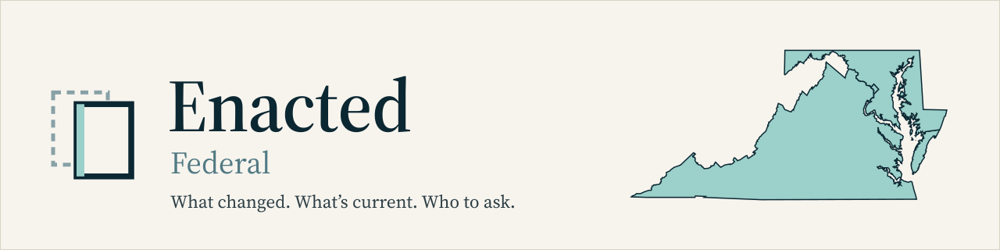

  <picture>
    <source media="(prefers-color-scheme: dark)" srcset="docs/readme/banner-dark.svg">
    
  </picture>

  
  
  
  

# Enacted: federal records

This repository records the enacted law. It does not advise, approve, determine, or certify anything.

Nothing here is legal advice, and using it does not create an attorney-client relationship with anyone. The government source cited in each record controls: a record may have been amended, superseded or corrected since it was fetched. If a decision depends on a rule, read the cited source and, where it matters, ask the office named for that jurisdiction or a licensed professional there.

These records appear alongside the state records on **[enacted.app](https://enacted.app/)**.

## What's in it

| Path | What it holds |
| :-- | :-- |
| `water/rules/` | Federal Register rulemaking notices on drinking water, one Markdown file per document |
| `coverage.json` | The scope this repository tracks |

Today that is one record: the Environmental Protection Agency's proposed rule extending the compliance deadline for the PFOA and PFOS maximum contaminant levels (91 FR 29425, Federal Register document 2026-10086, docket EPA-HQ-OW-2025-1742).

## Sources

Federal records come only from official federal publishers:

- GovInfo (`govinfo.gov`, U.S. Government Publishing Office)
- the Federal Register (`federalregister.gov`, National Archives and Records Administration)
- the United States Code (`uscode.house.gov`, Office of the Law Revision Counsel)

Each record names the document it quotes (`primary_source_url`, `source_pdf`), the SHA-256 of the exact file fetched (`source_sha256`) and when it was fetched, in UTC (`source_fetched_at`). Quoted text is copied mechanically from that file. Nothing in fetching or building these records calls an AI model.

## Checking a record yourself

Download the file named in `source_pdf` and compare its SHA-256 with the record's `source_sha256`.

## Reuse and licences

- **Records: CC0 1.0** ([LICENSE-DATA](LICENSE-DATA)). The record files and their YAML metadata, the contact files, the feeds, `coverage.json` and the documentation are dedicated to the public domain. Use them for anything, with no permission or credit needed. If you do give credit, a link to the cited government source is the most useful kind.
- **Code: MIT** ([LICENSE](LICENSE)). This repository holds no code yet; any added later is under MIT.
- **Not covered by either.** Text quoted from a government document keeps whatever status it has at its source; the dedication covers what Swapp Technologies added (the selection, structure and metadata). The Enacted name, its mark and the images in `docs/readme/` are not licensed.

## Corrections

If you find an error (a wrong date, a broken source link, a quote that doesn't match its source), open an issue on this repository with the record's path and the source you checked. A correction goes through the same checks as every other record.

Enacted can't say whether or how a rule applies to a particular property, project or license. The agency named in the record can answer questions about it.

## About

Published by Swapp Technologies LLC (Maryland). The site that presents these records is [enacted.app](https://enacted.app).

Related repositories: [enacted-state-md](https://github.com/Swapp-Technologies-LLC/enacted-state-md) · [enacted-state-dc](https://github.com/Swapp-Technologies-LLC/enacted-state-dc) · [enacted-state-va](https://github.com/Swapp-Technologies-LLC/enacted-state-va)
